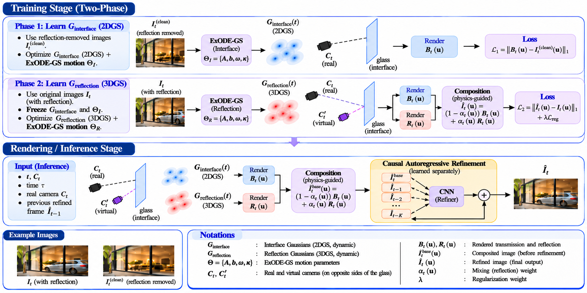

# ExODE-GS: Dynamic Scenes Through Glass with Causal Autoregressive Refinement

ExODE-GS reconstructs dynamic scenes seen through a planar glass surface (shop windows, glass partitions, display
cases) and renders them at new viewpoints and times. It separates the scene **behind** the glass from the
**reflection** on it, lets each move on its own, and refines the result frame by frame without looking at the future.



## Repository layout

| Part | Files |
|---|---|
| ExODE-GS motion | `scene/exode.py` (the motion parameters live in `scene/gaussian_field.py`) |
| Gaussian fields | `scene/interface_model.py` (2D disks with `p`, `o`), `scene/reflection_model.py` (3D ellipsoids) |
| Phase I | `train_interface.py`, `gaussian_renderer/interface.py` |
| Glass plane | `extract_plane.py`, `utils/plane_utils.py` |
| Phase II | `train_reflection.py`, `gaussian_renderer/reflection.py`, `gaussian_renderer/vigor.py`, `utils/virtual_camera.py`, `utils/fresnel.py` |
| Rendering | `render_vigor.py` → `<model>/test/ours_<N>/` |
| Refinement | `refiner/` (U-Net, RAFT flow, frame sequence), `train_refiner.py` → `<model>/test/refined_<M>/` |
| Evaluation | `metrics.py`, `analyze_components.py`, `make_component_figure.py` |
| Runners | `run_exode.py` (one scene), `run_main.py` (main experiment), `run_ablations.py` |
| Data preparation | `undistort_sources.py`, `convert.py` |
| Optional experiment | `train_joint.py` (joint fine-tuning of the reconstruction and the refiner) |
| Tests | `tests/` |

## Installation

Requirements: Linux, an NVIDIA GPU, CUDA 11.8, Python 3.10.

```shell
git clone https://github.com/iamkyledang/ex_ode_gs.git && cd ex_ode_gs

conda create -n exode python=3.10 -y && conda activate exode
pip install torch==2.0.1 torchvision==0.15.2 --index-url https://download.pytorch.org/whl/cu118
pip install -r requirements.txt

# CUDA extensions (rebuild after editing anything under submodules/)
pip install --no-build-isolation submodules/simple-knn
pip install --no-build-isolation submodules/diff-surfel-anych
pip install --no-build-isolation submodules/diff-gaussian-rasterization
pip install --no-build-isolation git+https://github.com/NVlabs/nvdiffrast   # only for the RT-Splatting baseline
```

The refiner uses torchvision's pretrained RAFT-small; its weights are downloaded on first use.

## Data

Each scene follows this layout:

```
<scene>/colmap/
├── images/          original frames I_t
├── sparse/0/        COLMAP model (PINHOLE cameras)
├── masks/           glass masks M_t (<stem>.png)
├── clean_image/     reflection-removed frames I_t^clean, aligned with images/
├── frames.json      per-frame metadata, including the timestamp t in [0, 1]
└── split.json       {"train": [...], "test": [...]}  (every fifth frame is a test frame)
```

If the masks and reflection-removed images were made on the distorted source frames, align them to the COLMAP images
first:

```shell
python undistort_sources.py -s <scene>
```

Benchmark scenes used in the project, with their training resolution:

| Dataset | Scene | Resolution flag | Images |
|---|---|---|---|
| VSGD | `0758` | `-r 1` | 1927 × 1080 |
| WayveScenes101 | `scene_001` | `-r 2` | 1636 × 612 |
| 3D-FRONT-T | `scene_1` | `-r 1` | 960 × 540 |

Place them as `<data_root>/VSGD/0758`, `<data_root>/WayveScene101/scene_001` and `<data_root>/3D-FRONT-T/scene_1`.

## Usage

### One scene, all stages

```shell
python run_exode.py --scene vsgd -m output/vsgd --data_root <data_root>     # scenes: vsgd, wayve, 3dfront
```

Each finished stage leaves a `.done_<stage>` marker, so rerunning the same command resumes an interrupted run.
Use `-s <scene> -r <n>` instead of `--scene` for your own data.

### Step by step

```shell
python train_interface.py -s <scene> -m <model> -r 1 --eval     # Phase I
python extract_plane.py   -m <model>                            # glass plane
python train_reflection.py -m <model>                           # Phase II
python render_vigor.py    -m <model> --skip_train               # composite        -> test/ours_30000
python train_refiner.py   -m <model>                            # refinement       -> test/refined_4000
python metrics.py         -m <model>                            # results.json for every folder in test/
```

Settings given to `train_interface.py` (scene, resolution, `--eval`, ...) are saved in `<model>/interface/cfg_args`
and reused by the later steps. Every training script checkpoints regularly and resumes when rerun.

### Main experiment and ablations

```shell
python run_main.py      --out output/main      --gpus 0,1 --data_root <data_root>   # 30k + 30k iterations, refiner 4k
python run_ablations.py --out output/ablations            --data_root <data_root>   # 12k + 12k iterations, refiner 2k
```

Both write `summary.csv` in their output folder. The ablation suite compares:

| Variant | What changes |
|---|---|
| full | the method with the short schedule |
| no ExODE-GS in `G_I` | the interface field is static (`--static_interface`) |
| no ExODE-GS in `G_R` | the reflection field is static (`--static_reflection`) |
| no ExODE-GS in either | both fields are static |
| no refinement | the composite `I_t^base` before the refiner |

### Component analysis

```shell
python analyze_components.py --test_dir <model>/test/ours_30000 --refined_dir <model>/test/refined_4000 \
    --scene_dir <scene> -r 1 --out components.json
python make_component_figure.py --out components.jpg \
    --panel VSGD <vsgd model>/test/ours_30000 19 \
    --panel WayveScenes101 <wayve model>/test/ours_30000 26 \
    --panel 3D-FRONT-T <3dfront model>/test/ours_30000 12
```

The first reports how much the reflection adds over the direct image, the distribution of the blending weight and the
accuracy of the predicted glass map; the second draws `I_t`, `B_t`, `R_t`, `α_t R_t`, `α_t` and `g_t` for one test
frame per dataset.

## Results

Final refined output on the test frames. `PSNR_M` is computed inside the glass mask and `PSNR_out` outside it; all
methods are scored with the same evaluation (same reference images, masks and resolution).

| Dataset | Method | PSNR_M ↑ | PSNR_out ↑ | PSNR ↑ | SSIM ↑ | LPIPS ↓ |
|---|---|---|---|---|---|---|
| VSGD | Deformable 3DGS | 32.28 | **38.68** | 34.30 | **0.9457** | 0.1811 |
| | SpectroMotion | 30.79 | 36.84 | 32.71 | 0.9313 | 0.2243 |
| | RT-Splatting | **33.27** | 37.28 | **34.77** | 0.9451 | **0.1671** |
| | **ExODE-GS** | 31.40 | 36.94 | 33.20 | 0.9346 | 0.2187 |
| WayveScenes101 | Deformable 3DGS | **27.27** | **26.95** | **26.80** | **0.9046** | **0.1224** |
| | SpectroMotion | 27.09 | 26.49 | 26.41 | 0.8942 | 0.1494 |
| | RT-Splatting | 24.76 | 23.52 | 23.58 | 0.8689 | 0.1492 |
| | **ExODE-GS** | 25.33 | 24.26 | 24.28 | 0.8582 | 0.1883 |
| 3D-FRONT-T | Deformable 3DGS | **28.82** | **32.54** | **30.95** | **0.8650** | **0.2198** |
| | SpectroMotion | 27.97 | 32.00 | 30.27 | 0.8579 | 0.2412 |
| | RT-Splatting | 28.55 | 31.61 | 30.22 | 0.8575 | 0.2295 |
| | **ExODE-GS** | 27.09 | 30.55 | 29.07 | 0.8402 | 0.2678 |

ExODE-GS does not yet match the strongest baselines on image quality. Its aim is a decomposition into an interpretable
direct image, reflection image and blending weight; the reflection layer raises in-glass PSNR over the direct image
alone by 5.68 dB on VSGD, 0.39 dB on WayveScenes101 and 2.58 dB on 3D-FRONT-T.

## Tests

```shell
python -m pytest -m "not data"     # unit tests (most need CUDA)
python -m pytest                   # also short training runs on a dev scene (set VIGOR_TEST_SCENE)
```

Lint and format with `ruff check .` and `ruff format .`.

## Acknowledgements and license

This code builds on [3D Gaussian Splatting](https://github.com/graphdeco-inria/gaussian-splatting),
[2D Gaussian Splatting](https://github.com/hbb1/2d-gaussian-splatting) and RT-Splatting, and uses RAFT from
torchvision. Parts derived from 3D Gaussian Splatting are under the Gaussian-Splatting license
([LICENSE.md](LICENSE.md), non-commercial research use); the RT-Splatting code is under the MIT license
([LICENSE](LICENSE)).
